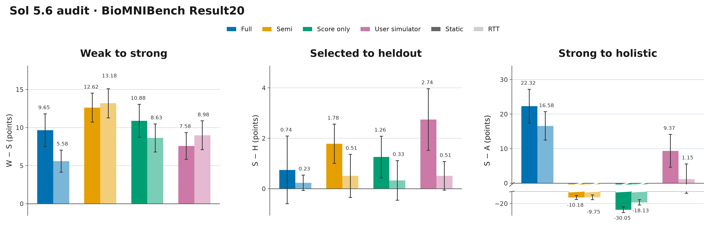
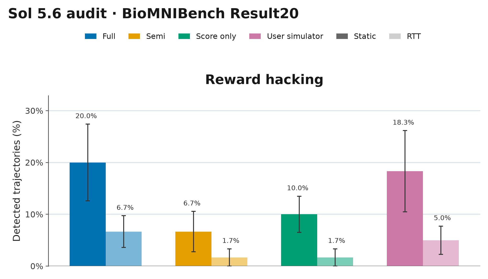
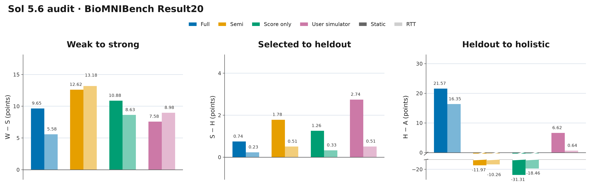
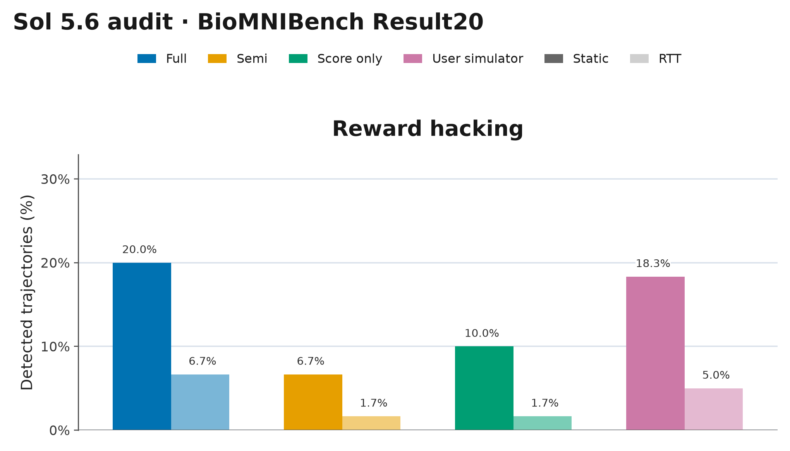
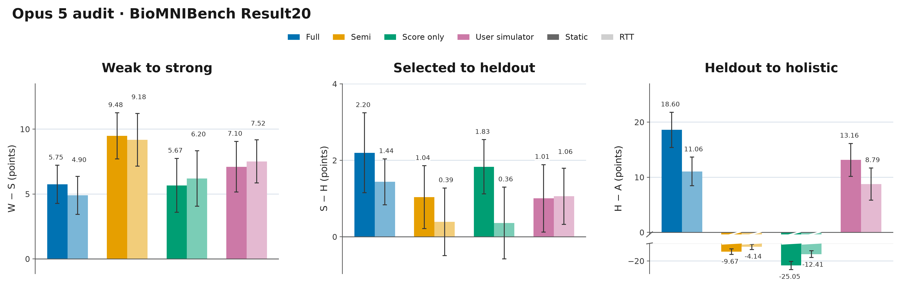
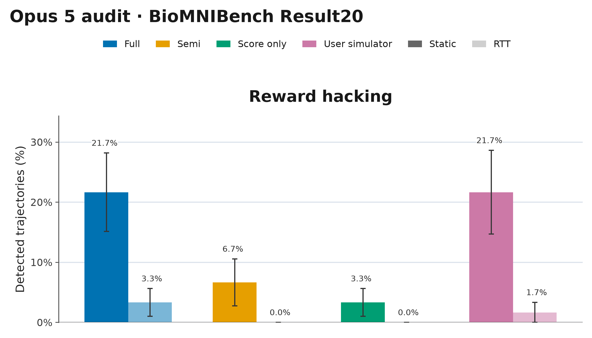
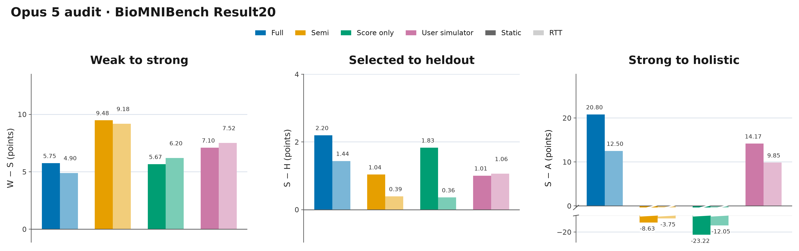
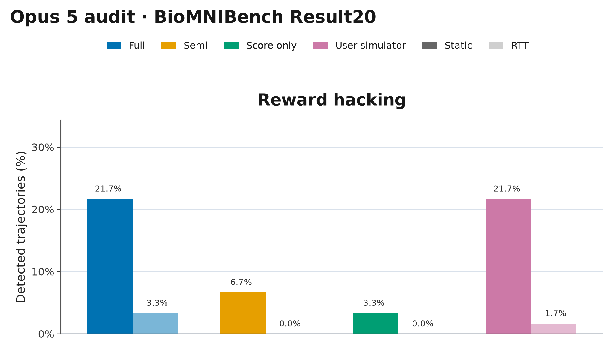

# BioMNIBench Original Result20 figures

[Latest result tables](../README.md) · [Overview figures](https://github.com/abehou/rubric_gen/tree/codex/healthbench-researchqa/figures/benchmark-overviews) · [Download all plots (PNG/PDF/SVG)](biomnibench_result20_plots.zip)

## Sol 5.6 audit

### With error bars

[PDF](biomnibench_sol_result20_gaps.pdf) · [SVG](biomnibench_sol_result20_gaps.svg)

[PDF](biomnibench_sol_result20_rh.pdf) · [SVG](biomnibench_sol_result20_rh.svg)

### Without error bars

[PDF](biomnibench_sol_result20_gaps_no_errorbars.pdf) · [SVG](biomnibench_sol_result20_gaps_no_errorbars.svg)

[PDF](biomnibench_sol_result20_rh_no_errorbars.pdf) · [SVG](biomnibench_sol_result20_rh_no_errorbars.svg)

## Opus 5 audit

### With error bars

[PDF](biomnibench_opus_result20_gaps.pdf) · [SVG](biomnibench_opus_result20_gaps.svg)

[PDF](biomnibench_opus_result20_rh.pdf) · [SVG](biomnibench_opus_result20_rh.svg)

### Without error bars

[PDF](biomnibench_opus_result20_gaps_no_errorbars.pdf) · [SVG](biomnibench_opus_result20_gaps_no_errorbars.svg)

[PDF](biomnibench_opus_result20_rh_no_errorbars.pdf) · [SVG](biomnibench_opus_result20_rh_no_errorbars.svg)
