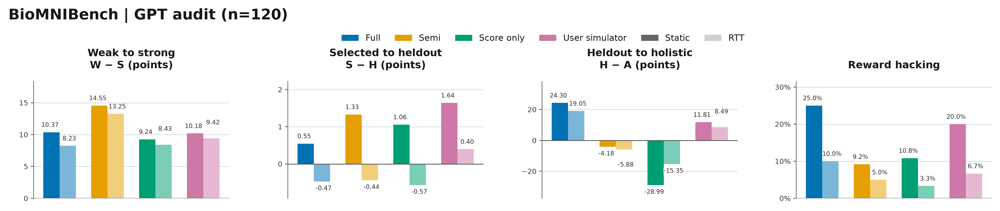
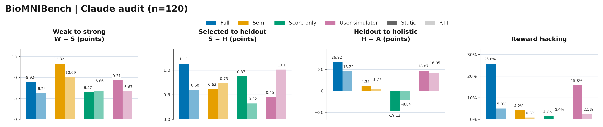
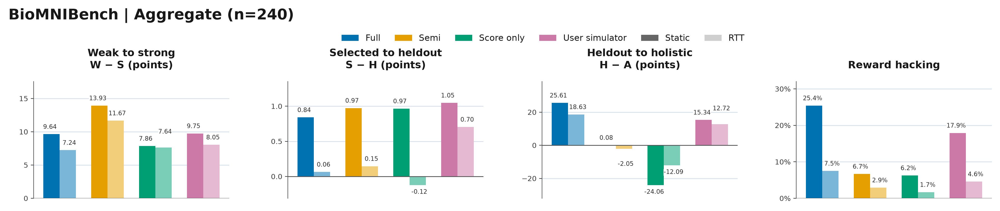

# BioMNIBench Result40

40 tasks × 3 replicates · Luna solver · latest retained results.

## GPT audit

| Condition | W | S | H | A | W−S | S−H | H−A | RH |
|---|---:|---:|---:|---:|---:|---:|---:|---:|
| Full Static | 97.72 | 87.35 | 86.80 | 62.50 | 10.37 | 0.55 | 24.30 | 30/120 (25.00%) |
| Full RTT | 92.39 | 84.16 | 84.63 | 65.58 | 8.23 | -0.47 | 19.05 | 12/120 (10.00%) |
| Semi Static | 75.95 | 61.40 | 60.07 | 64.25 | 14.55 | 1.33 | -4.18 | 11/120 (9.17%) |
| Semi RTT | 78.18 | 64.93 | 65.38 | 71.25 | 13.25 | -0.44 | -5.88 | 6/120 (5.00%) |
| Score-only Static | 56.23 | 46.98 | 45.92 | 74.92 | 9.24 | 1.06 | -28.99 | 13/120 (10.83%) |
| Score-only RTT | 65.84 | 57.42 | 57.99 | 73.33 | 8.43 | -0.57 | -15.35 | 4/120 (3.33%) |
| User Static | 89.38 | 79.20 | 77.56 | 65.75 | 10.18 | 1.64 | 11.81 | 24/120 (20.00%) |
| User RTT | 88.05 | 78.63 | 78.24 | 69.75 | 9.42 | 0.40 | 8.49 | 8/120 (6.67%) |

## Claude audit

| Condition | W | S | H | A | W−S | S−H | H−A | RH |
|---|---:|---:|---:|---:|---:|---:|---:|---:|
| Full Static | 97.72 | 88.80 | 87.67 | 60.75 | 8.92 | 1.13 | 26.92 | 31/120 (25.83%) |
| Full RTT | 92.39 | 86.15 | 85.55 | 67.33 | 6.24 | 0.60 | 18.22 | 6/120 (5.00%) |
| Semi Static | 75.95 | 62.63 | 62.02 | 57.67 | 13.32 | 0.62 | 4.35 | 5/120 (4.17%) |
| Semi RTT | 78.18 | 68.09 | 67.36 | 65.58 | 10.09 | 0.73 | 1.77 | 1/120 (0.83%) |
| Score-only Static | 56.23 | 49.75 | 48.88 | 68.00 | 6.47 | 0.87 | -19.12 | 2/120 (1.67%) |
| Score-only RTT | 65.84 | 58.98 | 58.66 | 67.50 | 6.86 | 0.32 | -8.84 | 0/120 (0.00%) |
| User Static | 89.38 | 80.08 | 79.62 | 60.75 | 9.31 | 0.45 | 18.87 | 19/120 (15.83%) |
| User RTT | 88.05 | 81.38 | 80.36 | 63.42 | 6.67 | 1.01 | 16.95 | 3/120 (2.50%) |

## Aggregate

| Condition | W | S | H | A | W−S | S−H | H−A | RH |
|---|---:|---:|---:|---:|---:|---:|---:|---:|
| Full Static | 97.72 | 88.08 | 87.23 | 61.62 | 9.64 | 0.84 | 25.61 | 61/240 (25.42%) |
| Full RTT | 92.39 | 85.15 | 85.09 | 66.46 | 7.24 | 0.06 | 18.63 | 18/240 (7.50%) |
| Semi Static | 75.95 | 62.02 | 61.04 | 60.96 | 13.93 | 0.97 | 0.08 | 16/240 (6.67%) |
| Semi RTT | 78.18 | 66.51 | 66.37 | 68.42 | 11.67 | 0.15 | -2.05 | 7/240 (2.92%) |
| Score-only Static | 56.23 | 48.37 | 47.40 | 71.46 | 7.86 | 0.97 | -24.06 | 15/240 (6.25%) |
| Score-only RTT | 65.84 | 58.20 | 58.32 | 70.42 | 7.64 | -0.12 | -12.09 | 4/240 (1.67%) |
| User Static | 89.38 | 79.64 | 78.59 | 63.25 | 9.75 | 1.05 | 15.34 | 43/240 (17.92%) |
| User RTT | 88.05 | 80.00 | 79.30 | 66.58 | 8.05 | 0.70 | 12.72 | 11/240 (4.58%) |

