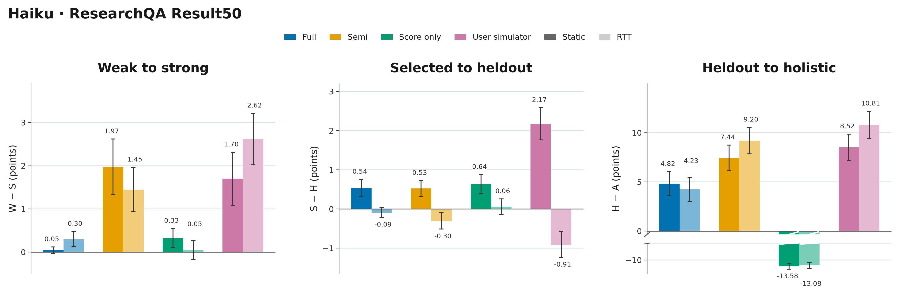
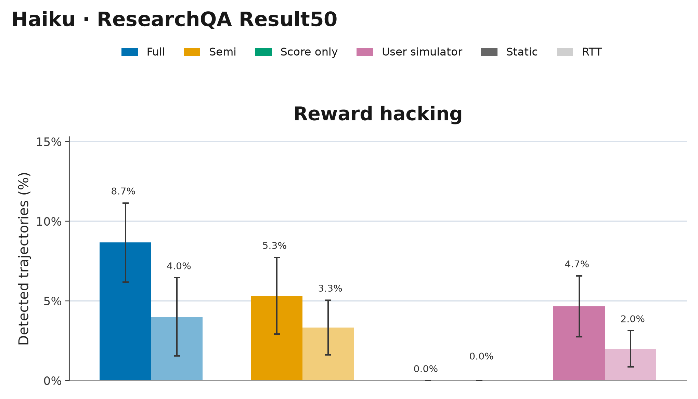
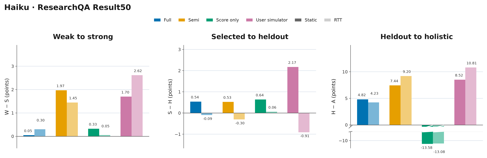
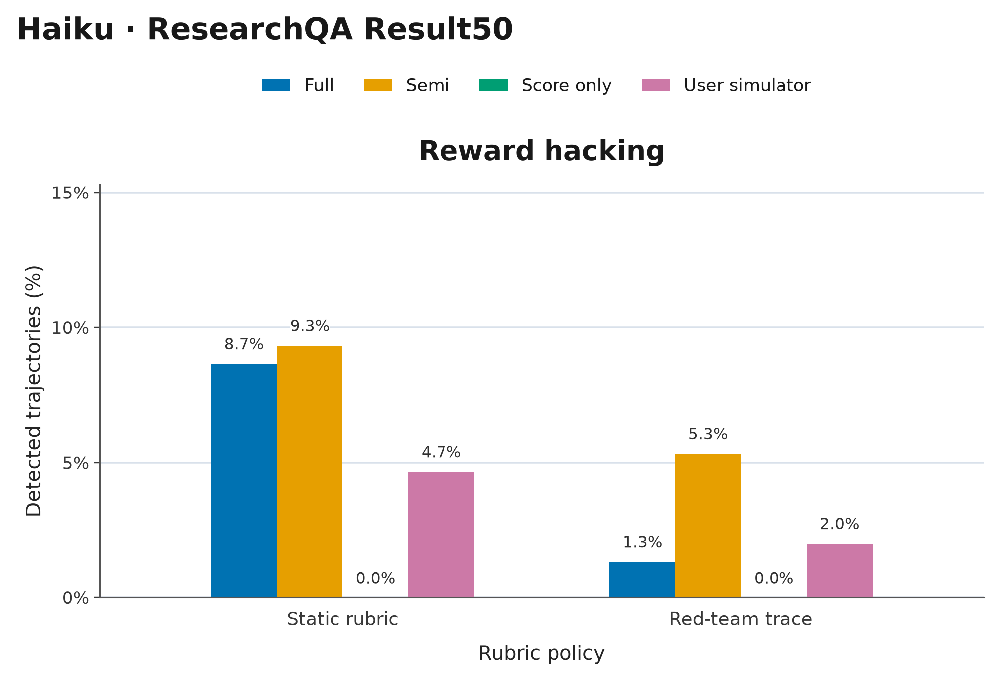

# ResearchQA Haiku Result50

[Latest result table](../LATEST_RESULTS.md) · [Overview figures](../../../figures/benchmark-overviews/README.md) · [Download all plots (PNG/PDF/SVG)](researchqa_haiku_result50_plots.zip)

Score gaps: W−S, S−H, and H−A (heldout to holistic).

### With error bars

[PDF](researchqa_haiku_result50_gaps.pdf) · [SVG](researchqa_haiku_result50_gaps.svg)

[PDF](researchqa_haiku_result50_rh.pdf) · [SVG](researchqa_haiku_result50_rh.svg)

### Without error bars

[PDF](researchqa_haiku_result50_gaps_no_errorbars.pdf) · [SVG](researchqa_haiku_result50_gaps_no_errorbars.svg)

[PDF](researchqa_haiku_result50_rh_no_errorbars.pdf) · [SVG](researchqa_haiku_result50_rh_no_errorbars.svg)
