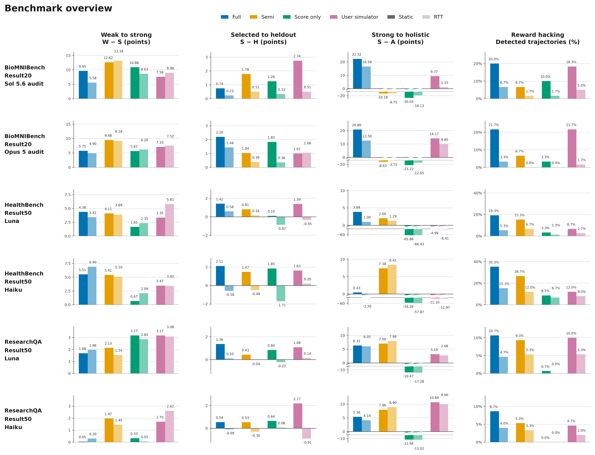
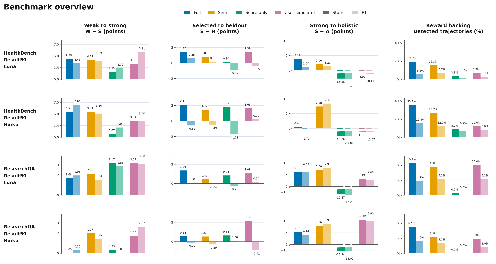

# Benchmark overviews

[Download both overviews (PNG/PDF/SVG)](benchmark_overviews.zip)

Paired Static/RTT bars without error bars. Colors identify feedback conditions; the lighter matching color identifies RTT. The S−A negative segment uses a compressed scale with explicit break marks, and the two result panels within each benchmark share scales.

## BioMNIBench, HealthBench and ResearchQA

[PNG](benchmark_overview_no_errorbars.png) · [PDF](benchmark_overview_no_errorbars.pdf) · [SVG](benchmark_overview_no_errorbars.svg)

## HealthBench and ResearchQA

[PNG](healthbench_researchqa_overview_no_errorbars.png) · [PDF](healthbench_researchqa_overview_no_errorbars.pdf) · [SVG](healthbench_researchqa_overview_no_errorbars.svg)

## Individual figures and result tables

- [HealthBench Luna](../../experiments/healthbench-hard-result50/figures/README.md)
- [HealthBench Haiku](../../experiments/healthbench-haiku50/figures/README.md)
- [ResearchQA Luna](../../experiments/researchqa-feedback50/figures/README.md)
- [ResearchQA Haiku](../../experiments/researchqa-haiku50/figures/README.md)
- [BioMNIBench Original20 Sol/Opus](https://github.com/abehou/rubric_gen/tree/codex/trace-v21-provenance-result20-babel/docs/reports/2026-10-12/biomnibench-original20/figures)
